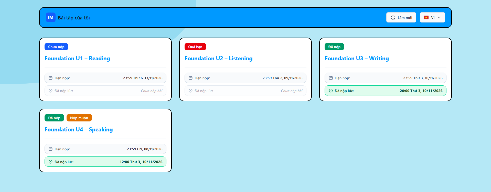
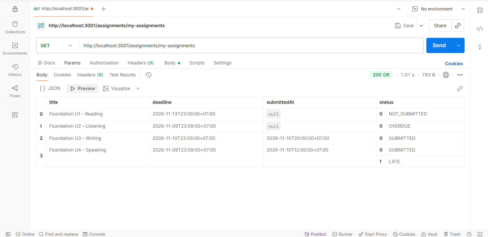
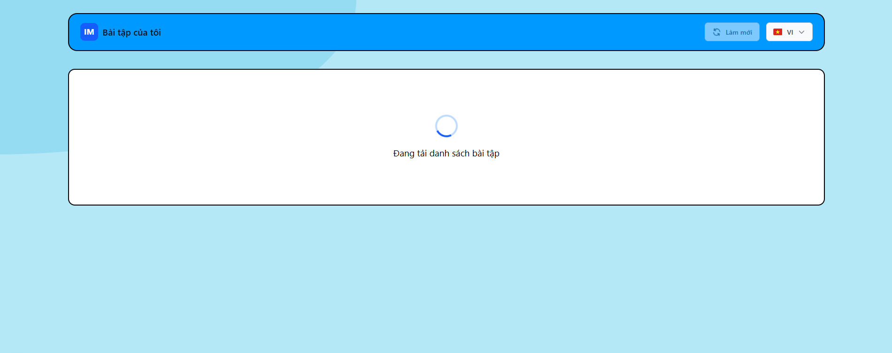
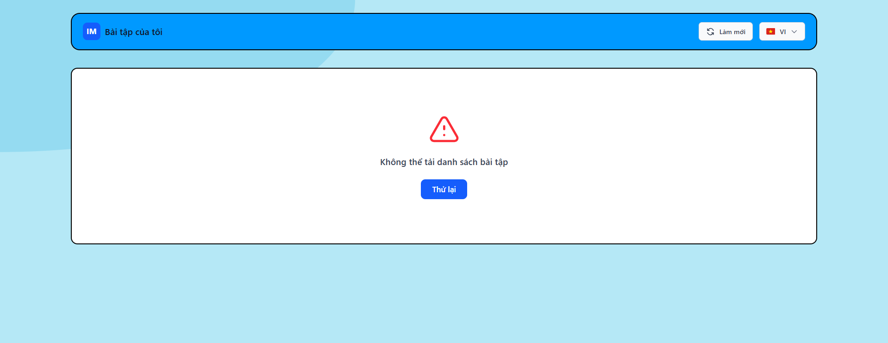

# 📚 IELTS Master - Dashboard “Bài tập của tôi”

Ứng dụng quản lý bài tập cá nhân dành cho học viên (Junior Full-stack Developer Assessment).

---

## 🛠 Công nghệ sử dụng

- **Frontend:** Next.js, Tailwind CSS, TypeScript.
- **Backend:** NestJS
- **Kiến trúc:** Component-based, hỗ trợ i18n (đa ngôn ngữ tiếng việt và tiếng anh), responsive trên cả máy tính, tablet và điện thoại.

---

## 📁Cấu trúc thư mục

- **student-assignment-fe:** Mã nguồn Frontend (Next.js).
- **assignment-api:** Mã nguồn Backend (NestJS)
- **File README:** Tài liệu hướng dẫn dự án

---

## ⏰ Mốc thời gian giả lập (Mocked Time)

Hệ thống sử dụng mốc thời gian cố định theo yêu cầu đề bài để tính toán trạng thái bài tập:

- **Thời điểm hiện tại giả lập:** `11/11/2026, 09:00 (GMT+7)`

---

## 🚀 Hướng dẫn cách chạy dự án (Quick Start)

1. **Cài đặt và chạy thư mục assignment-api (Backend):**

   ```bash
   # Di chuyển vào thư mục assignment-api
   cd assignment-api

   # Cài đặt các thư viện cần thiết
   yarn install / npm install

   # Khởi động server (chạy ở cổng 3001 - http://localhost:3001)
   yarn start / npm start
   ```

2. **Cài đặt và chạy thư mục student-assignments-fe (Frontend):**

   ```bash
   # Di chuyển vào thư mục student-assignments-fe
   cd student-assignments-fe

   # Cài đặt các thư viện cần thiết
   yarn install / npm install

   # Khởi động server (chạy ở cổng 3000 - http://localhost:3000)
   yarn dev / npm run dev
   Sau khi chạy thành công Backend và Frontend thì vui lòng mở http://localhost:3000 để xem kết quả
   ```

### ⚙️ Môi trường kiểm thử (Environment)

Dự án đã được phát triển và kiểm thử thành công trên môi trường thực tế sau:

- **Hệ điều hành:** Windows 11
- **Node.js:** `v22.23.3` (LTS) - **npm:** `v12.2.2` (hoặc Yarn `v1.22.22`)

## 🖥️ Hình ảnh minh họa (Screenshots)

Dưới đây là giao diện thực tế của Dashboard quản lý bài tập học viên (hỗ trợ chuyển đổi ngôn ngữ Anh - Việt và xử lý trực quan các trạng thái bài nộp):



## 🔒 Cơ chế bảo mật & Chống lộ dữ liệu S02

Để đáp ứng yêu cầu _“không lấy studentId từ URL làm xác thực”_, hệ thống xử lý bảo mật theo mô hình sau:

- **Định danh phía Server:** Dữ liệu học viên `S01` được giả lập ở Server.
- **Chặn thao tác giả mạo từ Client:** Client hoàn toàn không truyền tham số `?studentId=S01` hay `S02` lên URL hoặc Request Body. Do đó, học viên không thể thay đổi URL để cố tình truy cập hoặc trích xuất dữ liệu bài tập `B01` của `S02`.

## 🧪 Kết quả kiểm thử (Test Cases)

Ứng dụng đã được kiểm thử toàn diện trên cả **Backend API (Postman)** và **Giao diện Frontend** dựa trên mốc thời gian giả lập cố định **`11/11/2026, 09:00 (GMT+7)`**:

### 1. Kiểm thử Backend API (qua Postman)

- **Mục tiêu:** Kiểm tra service trả về đúng dữ liệu của học viên `S01`, tính toán chuẩn xác trạng thái và **chặn tuyệt đối** việc truy xuất dữ liệu của học viên khác (`S02` / `B01`).
- **Kết quả thực tế:**
  - Endpoint trả về chính xác danh sách 4 bài tập của `S01` (A01, A02, A03, A04).
  - Hoàn toàn không xuất hiện bài `B01` của `S02` (do API định danh ngầm định phía server, không nhận `studentId` từ query/params).
  - Trường trạng thái `status` được tính toán khớp tuyệt đối với mốc thời gian giả lập.
    

### 2. Kiểm thử Giao diện Frontend

- **Mục tiêu:** Kiểm tra hiển thị trực quan trên trình duyệt, các trạng thái loading, cảnh báo và bố cục responsive.
- **Kết quả thực tế hiển thị trên Dashboard:**

| Mã bài  | Tên bài                   | Hạn nộp (GMT+7)  | Thời gian nộp (GMT+7) | Trạng thái hiển thị  | Ghi chú / Kiểm tra                                |
| :------ | :------------------------ | :--------------- | :-------------------- | :------------------- | :------------------------------------------------ |
| **A01** | Foundation U1 – Reading   | 13/11/2026 23:59 | —                     | **Chưa nộp**         | Còn hạn, chưa đến hạn nộp                         |
| **A02** | Foundation U2 – Listening | 09/11/2026 23:59 | —                     | **Quá hạn**          | Đã quá hạn so với mốc giả lập (11/11)             |
| **A03** | Foundation U3 – Writing   | 10/11/2026 23:59 | 10/11/2026 20:00      | **Đã nộp**           | Nộp trước hạn                                     |
| **A04** | Foundation U4 – Speaking  | 08/11/2026 23:59 | 10/11/2026 12:00      | **Đã nộp + Nộp trễ** | Nộp sau hạn gốc (08/11)                           |
| **B01** | Foundation U1 – Reading   | 13/11/2026 23:59 | —                     | _Không hiển thị_     | Thuộc học viên S02, đã được API lọc bỏ thành công |

## ✨ Các tính năng mở rộng & Xử lý ngoại lệ (Features & Error Handling)

Bên cạnh các yêu cầu cốt lõi, dự án được bổ sung thêm các tính năng nâng cao nhằm tối ưu hóa trải nghiệm người dùng (UX) và đảm bảo tính ổn định của hệ thống:

### 1. Hệ thống đa ngôn ngữ (Localization - i18n)

- **Hỗ trợ chuyển đổi ngôn ngữ:** Giao diện tích hợp sẵn bộ chuyển đổi linh hoạt giữa **Tiếng Việt (vi)** và **Tiếng Anh (en)**.
- **Cơ chế lưu trữ:** Trạng thái ngôn ngữ được quản lý thông qua Context API và đồng bộ trực tiếp giúp người dùng duy trì trải nghiệm liền mạch khi chuyển trang hoặc tải lại ứng dụng.
  

### 2. Xử lý lỗi API toàn diện (API Error Handling & States)

- **Hiển thị trạng thái tải (Loading State):** Sử dụng các thành phần giao diện chờ trực quan (Skeleton / Loading Spinner) trong lúc Frontend đang chờ phản hồi từ Backend, tránh tình trạng giật giao diện (layout shift).
- **Xử lý lỗi kết nối / Lỗi Server (Error & Warning States):**
  - Khi API gặp sự cố (mất kết nối, timeout, hoặc lỗi 500 từ server), hệ thống bắt lỗi ở tầng gọi API và hiển thị thông báo lỗi thân thiện (Warning State / Error Banner) thay vì làm sập trang.
  - Cung cấp nút **Thử lại (Retry)** để người dùng có thể kích hoạt lại luồng gọi dữ liệu ngay lập tức mà không cần F5 lại toàn bộ trình duyệt.
    
    

### 3. Tính năng Tải lại dữ liệu (Refresh Action)

- **Làm mới thủ công:** Tích hợp nút **"Làm mới" (Refresh )** trực tiếp trên giao diện Dashboard và các thành phần cảnh báo lỗi.
- **Cơ chế hoạt động:** Cho phép người dùng chủ động kích hoạt lại yêu cầu lấy dữ liệu từ Backend khi có cập nhật mới khi thay đổi trạng thái bài tập.
